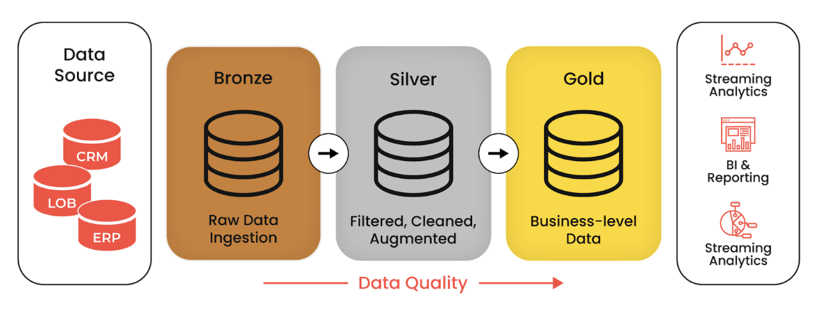
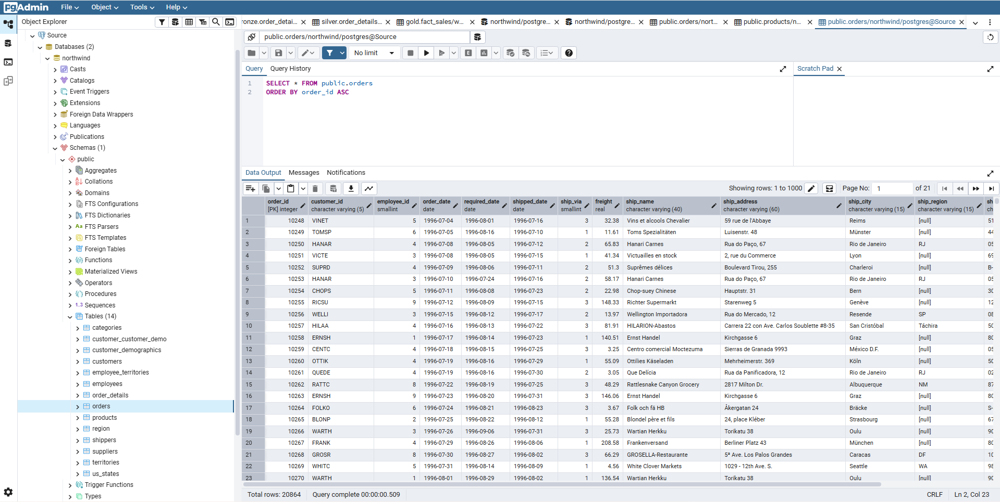
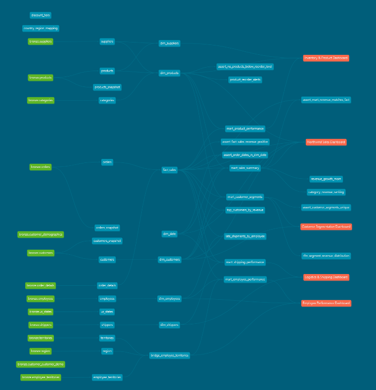
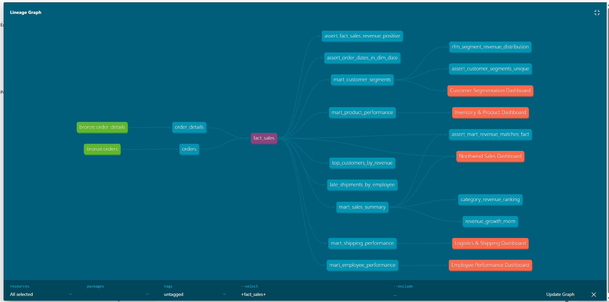
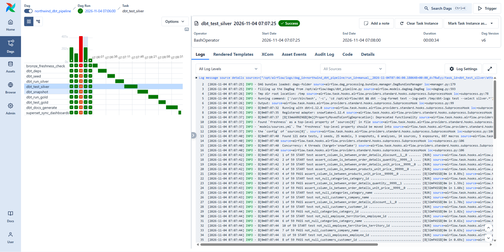
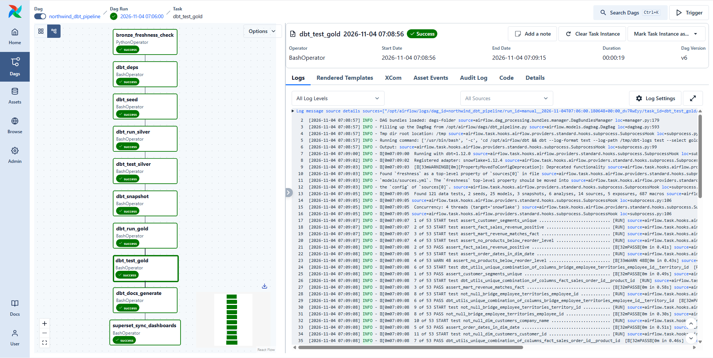
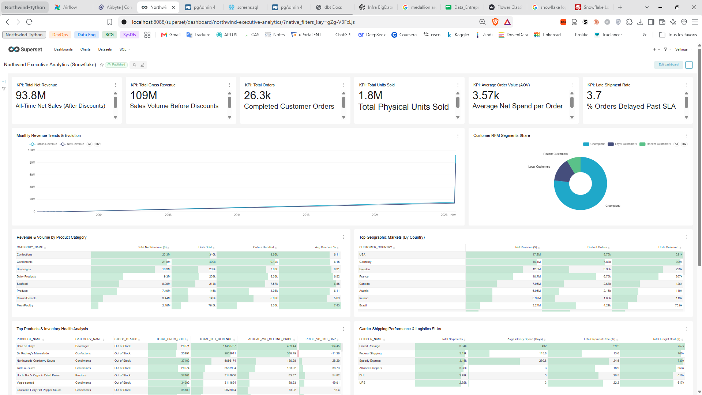
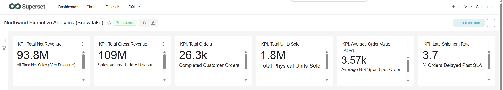

<div align="center">


&nbsp;&nbsp;&nbsp;&nbsp;


<br/>

# 🌐 Northwind Data Platform

**Production-grade Modern Data Stack built during an internship at [Tython](https://tython.co)**  
*ENSET Mohammedia · Data Engineering Internship · 2026*

<br/>

[](https://www.getdbt.com/)
[](https://airflow.apache.org/)
[](https://superset.apache.org/)
[](https://www.postgresql.org/)
[](https://www.snowflake.com/)
[](https://www.docker.com/)
[](https://airbyte.com/)

</div>

---

## 📖 Overview

This project migrates the classic **Northwind** OLTP database into a fully automated, cloud-ready **Modern Data Stack**. It was built end-to-end during a 2-month internship at **Tython**, implementing the complete data engineering lifecycle — from raw ingestion to executive dashboards.

> **Stack at a glance:** PostgreSQL source → Airbyte ingestion → Bronze/Silver/Gold dbt layers → Airflow orchestration → Superset dashboards → Snowflake cloud warehouse

<br/>

<div align="center">

<br/><sub>🏗️ Full data platform architecture</sub>
</div>

---

## 🏛️ Medallion Architecture

The pipeline follows the **Bronze → Silver → Gold** medallion pattern:

```
PostgreSQL (OLTP)
      │
      ▼  Airbyte (ELT)
   🥉 BRONZE   ──  Raw replicated tables (no transformation)
      │
      ▼  dbt (SQL transformations)
   🥈 SILVER   ──  Cleaned, typed, deduplicated tables
      │
      ▼  dbt (business models)
   🥇 GOLD     ──  Star schema: Facts, Dimensions, Mart aggregates
      │
      ▼  Apache Superset
  📊 DASHBOARDS ── Executive KPIs, RFM segmentation, operational metrics
```

<div align="center">

<br/><sub>🥉🥈🥇 Bronze → Silver → Gold data layers</sub>
</div>

---

## 🗂️ Project Structure

```
Northwind/
├── 📁 airflow/
│   ├── dags/
│   │   ├── dbt_pipeline.py        # Main orchestration DAG (10 tasks)
│   │   └── monitoring.py          # Data freshness & quality monitoring
│   └── requirements.txt
│
├── 📁 dbt/
│   ├── models/
│   │   ├── sources.yml            # Source definitions (Bronze tables)
│   │   ├── silver/                # Cleaned & typed models
│   │   └── gold/                  # Star schema + business marts
│   │       ├── fact_sales.sql
│   │       ├── dim_customers.sql
│   │       ├── dim_products.sql
│   │       ├── dim_employees.sql
│   │       ├── dim_date.sql
│   │       ├── mart_sales_summary.sql
│   │       ├── mart_customer_segments.sql   # RFM segmentation
│   │       ├── mart_employee_performance.sql
│   │       ├── mart_product_performance.sql
│   │       └── mart_shipping_performance.sql
│   ├── analyses/                  # Ad-hoc analytical SQL queries
│   ├── macros/                    # Reusable SQL macros
│   ├── seeds/                     # Reference data CSVs
│   ├── snapshots/                 # SCD Type 2 historical tracking
│   ├── tests/                     # Custom singular data tests
│   └── profiles/profiles.yml      # dbt connection profiles
│
├── 📁 compose/                    # Docker Compose service configs
├── 📁 infrastructure/
│   ├── source/                    # PostgreSQL source init & Docker
│   └── warehouse/                 # Warehouse schema & Snowflake init
├── 📁 scripts/
│   ├── data_generator.py          # Continuous OLTP data simulator v2
│   └── setup_superset.py          # Programmatic Superset dashboard setup
├── 📁 tests/
│   └── test_airflow_dags.py       # DAG integrity tests (pytest)
├── 📁 dbt-docs/                   # Pre-built dbt documentation site
├── 📁 .github/workflows/ci.yml    # GitHub Actions CI pipeline
├── docker-compose.yml             # Full stack orchestration
└── Makefile                       # Developer shortcuts
```

---

## 🔄 Data Pipeline

### Source: Northwind OLTP

The source PostgreSQL database contains the classic **Northwind** schema — 13 tables covering orders, customers, products, employees, shippers, and suppliers.

<div align="center">

<br/><sub>📐 Northwind source Entity-Relationship diagram</sub>
</div>

### dbt Lineage Graph

All transformations are version-controlled SQL models with full lineage tracked by dbt.

<div align="center">

<br/><sub>🔗 Full dbt lineage graph — Bronze to Gold</sub>
</div>

### Gold Layer: Star Schema

<div align="center">

<br/><sub>⭐ Gold layer star schema — fact_sales at the center</sub>
</div>

---

## ✈️ Airflow Orchestration

The pipeline is fully automated with **Apache Airflow**. The main DAG runs on a daily schedule and executes 10 sequential tasks:

| Task | Description |
|------|-------------|
| `bronze_freshness_check` | Validates raw data was ingested within 24h |
| `dbt_run_silver` | Runs all Silver cleaning models |
| `dbt_test_silver` | Tests Silver data quality |
| `dbt_run_gold_dims` | Builds dimension tables |
| `dbt_run_gold_facts` | Builds fact tables |
| `dbt_run_gold_marts` | Builds mart aggregations |
| `dbt_snapshot` | Runs SCD Type 2 snapshots |
| `dbt_test_gold` | Runs all Gold data tests |
| `dbt_docs_generate` | Regenerates dbt documentation |
| `notify_success` | Sends pipeline success notification |

<div align="center">

<br/><sub>✅ Airflow DAG Grid View — all tasks successful</sub>
</div>

<div align="center">

<br/><sub>🔀 Task dependency graph</sub>
</div>

---

## 📊 Superset Dashboards

**14 production charts** served via Apache Superset:

| Chart | Description |
|-------|-------------|
| 💰 Revenue Trend | Monthly revenue evolution with MoM growth |
| 🧩 RFM Segmentation | Customer segments: Champions, Loyal, At-Risk, Lost |
| 🏆 Top Products | Revenue & units sold ranking |
| 👥 Employee Leaderboard | Sales performance by employee |
| 🚚 Shipping Performance | On-time delivery rate by shipper |
| 📦 Inventory Alerts | Products below reorder level |
| 🌍 Revenue by Country | Geographic revenue heatmap |
| 📈 Order Volume Trend | Daily/weekly order count |

<div align="center">

<br/><sub>📊 Superset Executive Analytics Dashboard</sub>
</div>

<div align="center">

<br/><sub>🎯 KPI Scorecard — Total Revenue, Orders, Customers, Avg Order Value</sub>
</div>

---

## 🚀 Quick Start

### Prerequisites

- Docker & Docker Compose
- 8 GB RAM minimum
- Ports free: `8080` (Airflow), `8081` (Superset), `5432` (PostgreSQL), `8000` (Airbyte)

### 1. Clone & configure

```bash
git clone https://github.com/Ayoub-ALOUANE/Northwind.git
cd Northwind
cp .env.example .env   # Fill in your credentials
```

### 2. Start the full stack

```bash
docker compose up -d
# or use the Makefile
make up
```

### 3. Initialize everything

```bash
# Initialize Airflow
make airflow-init

# Run initial dbt pipeline
make dbt-run

# Setup Superset dashboards
make superset-setup
```

### 4. Access the services

| Service | URL | Credentials |
|---------|-----|-------------|
| 🌬️ Airflow | http://localhost:8080 | `admin` / `admin` |
| 📊 Superset | http://localhost:8088 | `admin` / `admin` |
| 🔄 Airbyte | http://localhost:8000 | `airbyte` / `password` |
| 🗃️ pgAdmin | http://localhost:5050 | see `.env` |
| 📚 dbt Docs | http://localhost:8085 | — |

---

## 🛠️ Key Makefile Commands

```bash
make up              # Start all services
make down            # Stop all services
make dbt-run         # Run full dbt pipeline
make dbt-test        # Run all data tests
make dbt-docs        # Generate & serve dbt docs
make airflow-logs    # Stream Airflow scheduler logs
make superset-setup  # Initialize Superset dashboards
make generate-data   # Start continuous data generator
make lint            # SQLFluff lint on all models
```

---

## 🧪 Data Quality & Testing

### dbt Tests
- **Schema tests**: `not_null`, `unique`, `accepted_values`, `relationships` on every model
- **Singular tests**: Custom SQL assertions validating business rules

```bash
# Run all tests
docker compose exec dbt dbt test

# Example custom tests
tests/assert_fact_sales_revenue_positive.sql
tests/assert_customer_segments_unique.sql
tests/assert_mart_revenue_matches_fact.sql
tests/assert_no_products_below_reorder_level.sql
tests/assert_order_dates_in_dim_date.sql
```

### CI/CD
GitHub Actions workflow (`.github/workflows/ci.yml`) runs on every push:
- ✅ Airflow DAG integrity tests (pytest)
- ✅ SQLFluff SQL linting
- ✅ dbt compile & dependency validation

---

## 📸 More Screenshots

<details>
<summary>🔍 Click to expand more screenshots</summary>

<br/>

**dbt Documentation Site**

The project ships with a pre-built dbt documentation site in `dbt-docs/` with full model descriptions, column-level lineage, and test coverage.

**SCD Type 2 Snapshots**

Historical tracking is implemented for `customers`, `orders`, and `products` tables — capturing state changes over time with `dbt snapshot`.

**Data Generator v2**

`scripts/data_generator.py` runs in continuous stream mode inside the `postgres-source` container, simulating realistic OLTP activity:
- Random new orders every 10–60 seconds
- Inventory replenishment cycles
- Product price updates
- Customer registration events

</details>

---

## ⚙️ Environment Variables

Create a `.env` file at the project root:

```env
# PostgreSQL Source
POSTGRES_SOURCE_USER=postgres
POSTGRES_SOURCE_PASSWORD=your_password
POSTGRES_SOURCE_DB=northwind

# PostgreSQL Warehouse
POSTGRES_WH_USER=postgres
POSTGRES_WH_PASSWORD=your_password
POSTGRES_WH_DB=warehouse

# Snowflake (optional — for cloud target)
SNOWFLAKE_ACCOUNT=your_account
SNOWFLAKE_USER=your_user
SNOWFLAKE_PASSWORD=your_password
SNOWFLAKE_DATABASE=NORTHWIND
SNOWFLAKE_WAREHOUSE=COMPUTE_WH
SNOWFLAKE_ROLE=ACCOUNTADMIN

# Airflow
AIRFLOW_UID=50000
AIRFLOW__CORE__FERNET_KEY=your_fernet_key
```

---

## 📚 Documentation

- **[Architecture Overview](docs/architecture.md)** — detailed system design decisions
- **[dbt Docs](dbt-docs/index.html)** — model documentation & lineage (open locally)
- **[Instructions](Instructions)** — project setup & context notes

---

## 🏗️ Tech Stack

| Layer | Technology | Purpose |
|-------|-----------|---------|
| **Source** | PostgreSQL 16 | OLTP source database (Northwind) |
| **Ingestion** | Airbyte | CDC / ELT replication to Bronze |
| **Transformation** | dbt 1.12 | SQL models, tests, docs |
| **Orchestration** | Apache Airflow 2.x | DAG scheduling & monitoring |
| **Warehousing** | PostgreSQL + Snowflake | Local dev + cloud production |
| **Visualization** | Apache Superset | Executive dashboards |
| **Containerization** | Docker Compose | Full local stack |
| **CI/CD** | GitHub Actions | Automated testing & linting |
| **SQL Quality** | SQLFluff | Linting & formatting |

---

## 👨‍💻 Author

<div align="center">

**Ayoub Alouane**  
Data Engineering Intern · ENSET Mohammedia  
Supervised by **Youssef Fatih** · [Tython](https://tython.co)

<br/>

[](https://github.com/Ayoub-ALOUANE)

</div>

---

<div align="center">
<sub>Built with ❤️ during internship at <strong>Tython</strong> · 2026</sub>
</div>
