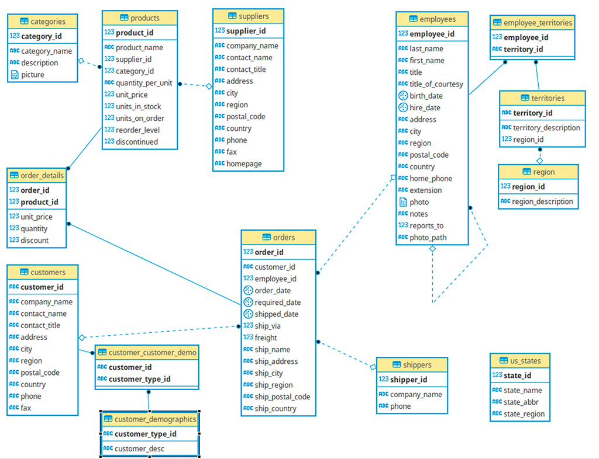
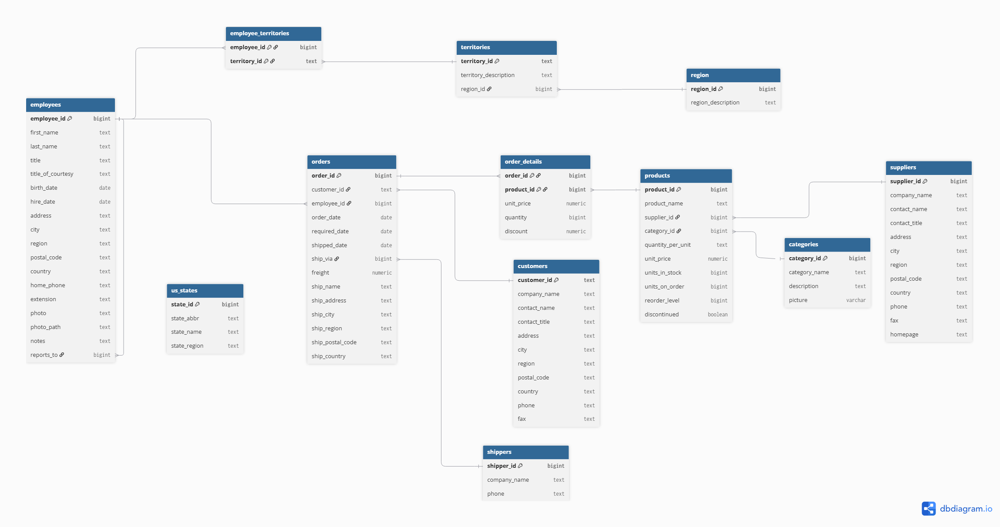

# Northwind Data Platform

A fully containerized, end-to-end data engineering pipeline built on the classic **Northwind** trading company dataset. The platform ingests raw operational data, transforms it through a multi-layer data warehouse (Bronze → Silver → Gold), and exposes analytics-ready dimensional models for business intelligence.

---

## Table of Contents

- [Overview](#overview)
- [Architecture](#architecture)
- [Tech Stack](#tech-stack)
- [Project Structure](#project-structure)
- [Data Model](#data-model)
  - [Source Database (Bronze)](#source-database-bronze)
  - [Silver Layer](#silver-layer)
  - [Gold Layer — Star Schema](#gold-layer--star-schema)
- [Services & Ports](#services--ports)
- [Getting Started](#getting-started)
  - [Prerequisites](#prerequisites)
  - [Environment Variables](#environment-variables)
  - [Running the Platform](#running-the-platform)
- [dbt Pipeline](#dbt-pipeline)
- [Airflow DAG](#airflow-dag)

---

## Overview

The Northwind Data Platform demonstrates a production-style data stack using industry-standard open-source tools. It covers:

- **Data Ingestion** — Airbyte replicates the Northwind source PostgreSQL database into the warehouse Bronze schema.
- **Data Transformation** — dbt models clean, validate, and reshape raw data into analysis-ready Silver views and Gold dimension/fact tables.
- **Orchestration** — Apache Airflow schedules and executes the dbt build pipeline.
- **Visualization** — Apache Superset connects to the Gold layer for dashboards and exploration.
- **Database Management** — pgAdmin provides a GUI for inspecting all PostgreSQL databases.

---

## Architecture

The pipeline follows the **Medallion Architecture** (Bronze / Silver / Gold):

```
+------------------------------------------------------------------+
|                        Source System                             |
|          PostgreSQL (Northwind OLTP database)                    |
|                    port 55432                                    |
+-----------------------------+------------------------------------+
                              |  Airbyte CDC / Full Refresh
                              v
+------------------------------------------------------------------+
|                     Data Warehouse                               |
|               PostgreSQL  (port 55433)                          |
|                                                                  |
|   +----------+    +----------+    +----------------------+      |
|   |  Bronze  |    |  Silver  |    |        Gold          |      |
|   | raw copy |--> | cleaned  |--> |  Star Schema (dims   |      |
|   | from src |    |  views   |    |  + fact_sales table) |      |
|   +----------+    +----------+    +----------------------+      |
+------------------------------------------------------------------+
                              |
                              v
                 +-----------------------+
                 |   Apache Superset     |
                 |   (port 8088)         |
                 +-----------------------+
```

**Orchestration:** Apache Airflow (port 8081) triggers `dbt build` on demand, executing all models, tests, and snapshots in dependency order.

---

## Tech Stack

| Component | Tool | Version |
|---|---|---|
| Containerization | Docker Compose | — |
| Source Database | PostgreSQL | 16 |
| Data Warehouse | PostgreSQL | 16 |
| Ingestion | Airbyte | (via Docker image) |
| Transformation | dbt Core + dbt-postgres | 1.12.0 / 1.11.0 |
| dbt Package | dbt-utils | >=1.0.0, <2.0.0 |
| Orchestration | Apache Airflow | 3.1.0 |
| Visualization | Apache Superset | latest |
| DB Management | pgAdmin 4 | latest |

---

## Project Structure

```
Northwind/
├── docker-compose.yml          # Main entry point — includes all compose files
│
├── compose/                    # Per-service Docker Compose definitions
│   ├── postgres.yml            # Source DB, Warehouse DB, Airflow metadata DB
│   ├── airflow.yml             # Airflow scheduler, API server, DAG processor, init
│   ├── airbyte.yml             # Airbyte ingestion platform
│   ├── pgadmin.yml             # pgAdmin 4 GUI
│   ├── superset.yml            # Apache Superset BI
│   └── infrastructure.yml      # Shared network and named volumes
│
├── airflow/
│   ├── Dockerfile              # Custom Airflow image (adds git + dbt)
│   ├── requirements.txt        # dbt-core, dbt-postgres, psycopg2-binary
│   ├── dags/
│   │   └── dbt_pipeline.py     # DAG: runs `dbt build` against the warehouse
│   ├── plugins/
│   └── config/
│
├── dbt/
│   ├── dbt_project.yml         # Project config: Silver = views, Gold = tables
│   ├── packages.yml            # dbt-utils dependency
│   ├── profiles/               # dbt connection profiles (injected at runtime)
│   ├── models/
│   │   ├── sources.yml         # Bronze schema source declarations
│   │   ├── silver/             # 12 cleaned views (one per source table)
│   │   └── gold/               # Dimensional model: 5 dims + 1 fact + 1 bridge
│   ├── seeds/
│   ├── tests/
│   ├── macros/
│   ├── snapshots/
│   └── analyses/
│
├── infrastructure/
│   ├── source/
│   │   └── northwind.sql       # Full Northwind database initialization script
│   └── warehouse/
│       └── init.sql            # Warehouse schema initialization
│
└── docs/
    ├── ER.png                  # Source entity-relationship diagram
    ├── Silver.png              # Silver layer schema diagram
    ├── pipeline.png            # End-to-end pipeline diagram
    └── star_schema.png         # Gold layer star schema diagram
```

---

## Data Model

### Source Database (Bronze)

The source is the classic **Northwind** relational database, representing a fictional trading company. Airbyte replicates all tables into the `bronze` schema of the warehouse database.

**Source tables:**

| Table | Description |
|---|---|
| `orders` | Customer orders with shipping details |
| `order_details` | Line items per order (product, quantity, price, discount) |
| `customers` | Customer contact and address information |
| `employees` | Employee records with territory assignments |
| `employee_territories` | Many-to-many: employees to territories |
| `products` | Product catalog with pricing and inventory |
| `categories` | Product category groupings |
| `suppliers` | Supplier contact and location data |
| `shippers` | Shipping carrier information |
| `territories` | Sales territory definitions |
| `region` | Regional groupings for territories |
| `us_states` | US state reference data |

**Source entity-relationship diagram:**



---

### Silver Layer

Silver models are **views** in the `public` schema of the warehouse. Each model maps 1-to-1 to a Bronze source table and applies:

- `TRIM()` on all string columns to remove leading and trailing whitespace
- `NULLIF()` on optional fields (e.g., `ship_region`) to standardize nulls
- `_airbyte_extracted_at` exposed as `loaded_at` for data lineage tracking
- dbt data quality tests: `unique`, `not_null`, and `relationships` checks on all key columns

**Silver schema diagram:**



---

### Gold Layer — Star Schema

Gold models are **materialized tables** in the `gold` schema. They implement a **star schema** optimized for analytical queries and BI tools.

**Dimension tables:**

| Model | Description |
|---|---|
| `dim_customers` | Customer dimension |
| `dim_employees` | Employee dimension |
| `dim_products` | Product dimension enriched with category name and supplier details |
| `dim_shippers` | Shipper dimension |
| `dim_date` | Date dimension — generated date spine covering order, required, and shipped dates |
| `bridge_employee_territories` | Bridge table for the employee-territory many-to-many relationship |

**Fact table:**

| Model | Grain | Description |
|---|---|---|
| `fact_sales` | One row per order line item (`order_id` + `product_id`) | Sales facts: quantity, unit price, discount, and foreign keys to all dimensions. Surrogate key generated with `dbt_utils.generate_surrogate_key`. |

**Gold star schema:**


---

## Services & Ports

| Service | URL | Default Credentials |
|---|---|---|
| Airflow API / UI | http://localhost:8081 | `admin` / `admin` |
| Superset | http://localhost:8088 | Set on first login |
| pgAdmin | http://localhost:5051 | `pgadmin4@pgadmin.org` / `postgres` |
| PostgreSQL Source | `localhost:55432` | `postgres` / `postgres` — db: `northwind` |
| PostgreSQL Warehouse | `localhost:55433` | `postgres` / `postgres` — db: `warehouse` |
| PostgreSQL Airflow DB | `localhost:55434` | `airflow` / `airflow` — db: `airflow` |

---

## Getting Started

### Prerequisites

- [Docker Desktop](https://www.docker.com/products/docker-desktop/) with Docker Compose v2
- At least **8 GB of RAM** allocated to Docker

### Environment Variables

The `.env` file at the project root is required by the Airflow containers. It ships with pre-generated values and does not need to be changed for local development:

```env
AIRFLOW__CORE__FERNET_KEY=<fernet_key>
AIRFLOW__API__SECRET_KEY=<api_secret>
AIRFLOW__API_AUTH__JWT_SECRET=<jwt_secret>
```

> **Note:** Rotate these keys before deploying to any non-local environment.

### Running the Platform

**1. Create the required external Docker volumes** (first time only):

```bash
docker volume create source_postgresql_data
docker volume create warehouse_warehouse_data
docker volume create source_pgadmin_root_prefs
docker volume create source_pgadmin_working_dir
```

**2. Start all services:**

```bash
docker compose up -d
```

This starts the following containers:
- 3 PostgreSQL instances (source, warehouse, Airflow metadata)
- Airflow (init container, scheduler, API server, DAG processor)
- Airbyte
- pgAdmin
- Apache Superset

**3. Wait for Airflow to initialize.**

The `airflow-init` container runs database migrations and creates the default admin user. Monitor its progress:

```bash
docker compose logs airflow-init
```

**4. Configure Airbyte** to replicate all Northwind tables from `postgres-source` (port 55432) to the `bronze` schema in `postgres-warehouse` (port 55433).

**5. Trigger the dbt pipeline** via the Airflow UI at http://localhost:8081. Find the `northwind_dbt_pipeline` DAG and trigger it manually.

**6. Connect Superset** to the warehouse database and explore the `gold` schema for analytics and dashboards.

---

## dbt Pipeline

The dbt project builds models in two layers:

| Layer | Materialization | Schema | Description |
|---|---|---|---|
| Silver | `view` | `public` | Cleaned and validated source tables |
| Gold | `table` | `gold` | Dimensional model (dimensions + fact table) |

Run the full pipeline (models + tests + snapshots) locally:

```bash
cd dbt
dbt deps
dbt build --profiles-dir profiles
```

Run only a specific layer:

```bash
dbt build --select silver.*
dbt build --select gold.*
```

---

## Airflow DAG

The DAG `northwind_dbt_pipeline` is defined in `airflow/dags/dbt_pipeline.py`.

| Property | Value |
|---|---|
| DAG ID | `northwind_dbt_pipeline` |
| Schedule | Manual trigger only (`schedule=None`) |
| Catchup | Disabled |
| Tags | `northwind`, `dbt` |
| Task | `dbt_build` — runs `dbt build` via `BashOperator` |

The Airflow containers have the entire `dbt/` directory mounted at `/opt/airflow/dbt`. The `DBT_PROFILES_DIR` environment variable points to `/opt/airflow/dbt/profiles` so dbt can connect to the warehouse database from within the container.
